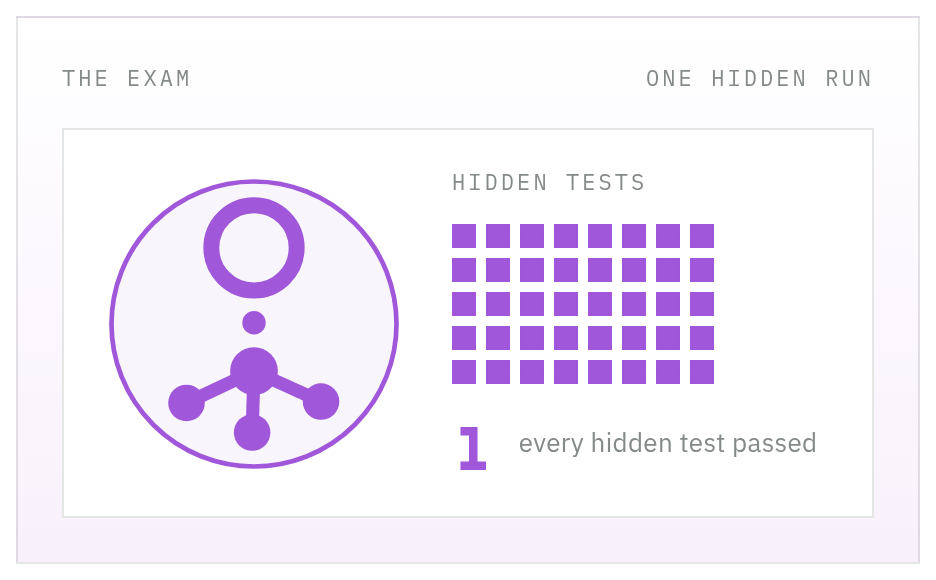
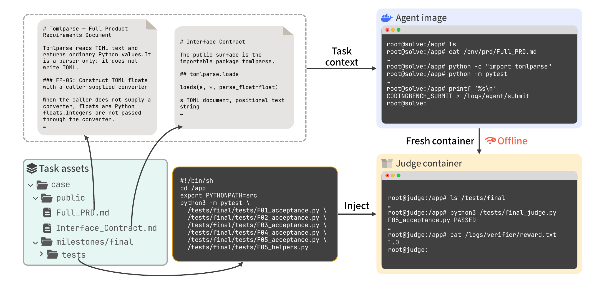

<div align="center">



# Zero2Repo

### Can coding agents build repositories from scratch?

**A product spec, an empty workspace, and hidden acceptance tests. The agent builds the repository.**

[](https://arxiv.org/abs/2609.38269)
[](https://zero2repo.ai/)
[](https://github.com/Gradient-Data/Zero2Repo/stargazers)

[**Website**](https://zero2repo.ai/) ·
[**Paper**](https://arxiv.org/abs/2609.38269) ·
[**PDF**](zero2repo.pdf)

Formerly CodingBench. Same exam. Clearer name.

</div>

<p align="center">
  
</p>

<p align="center">
<em>One task, from the public specification to a binary reward. The agent builds in an empty workspace. After an explicit submission, a fresh offline container receives the hidden tests and writes the reward.</em>
</p>

Zero2Repo evaluates coding agents on **repo-scale, from-scratch** tasks.

The agent receives a product spec and an empty workspace, implements the project
in a real shell environment, and is scored by **hidden, deterministic acceptance
tests** (binary reward: `1.0` / `0.0`). No LLM-as-judge.

This repository ships:

- **17 released cases** under `benchmark/cases/`: Tomlparse, python-envfile, ymlcodec (TypeScript), Signtoken, httpwire, Optlyn, Otpkit, Hrefparse (C++), Git Orbulk (Go), Lingora, PathSel (Python), lint-policy (TypeScript), Membundle (Go), Navfilter (C11), oggrepack (C99), prosecheck (Python and Node), and klyvmap (Zig)
- The **`cbrun`** harness (recommended)
- An optional **Harbor** adapter

---

## Why Zero2Repo

Most coding benchmarks either hand the agent an existing repository and ask for a
patch (SWE-bench, Terminal-Bench), or ask for a single function in an isolated
sandbox (HumanEval, MBPP). Neither measures the workflow that real users lean on
most: **give an agent a requirements document and let it build the whole project
from nothing.**

Zero2Repo targets exactly that gap. Every case asks the agent to:

1. **Read a full natural-language spec** and recover module boundaries, data
   flow, behavioral constraints and a public interface contract.
2. **Work multi-turn in a real CLI harness** (Codex, Claude Code, OpenCode,
   Cursor): plan, implement, self-test, debug, iterate.
3. **Deliver a working repository from an empty directory** — directory layout,
   dependencies, build configuration, the lot.

Scoring is outcome-based: a hidden acceptance suite checks public behavior
against the spec in a reproducible Docker environment. No partial credit for
code that "looks right", and no LLM in the loop deciding the score.

---

## What makes the data different

### Real repositories, not LLM-synthesized tasks

Each case is derived from a **real, actively maintained open-source project**
pinned at a fixed commit. The PRD is a reverse-engineered abstraction of what
that project actually does; the acceptance tests are grounded in the project's
real, runnable behavior; the environment is a real `install` / `build`
toolchain. Language models help read code, draft text and run commands during
authoring, but they never invent the task, the behavior or the ground truth.
Every requirement traces back to something that exists and runs.

This is why case difficulty tracks real engineering rather than a hand-shrunk
puzzle — and why the cases are hard to memorize: public specs are neutralized so
the agent cannot simply recall the upstream repository.

### Language-agnostic by construction

The authoring process makes no assumptions about language, build system or test
framework. This release currently ships eight Python cases, one Python-and-Node
case, two TypeScript cases, two Go cases, one C++ case, two C cases, and one
Zig case. New ecosystems are a matter of adding seed repositories, not rewriting
the harness.

### Fully automated, so it scales

Cases are produced by an **automated, evidence-gated authoring process** rather
than hand-written one at a time. Every generated artifact must pass deterministic
checks against real code and real tests before release; anything that cannot be
verified stays in draft. Case count scales with compute, not with headcount.

### One source, three kinds of assets

The same authored case yields, from a single run:

- a **benchmark package** — public PRD + interface contract + hidden acceptance
  suite + reproducible environment (what this repository ships);
- **SFT trajectories** — step-wise development traces with real test feedback;
- **RL environments** — the same containerized task with a deterministic,
  verifiable reward.

Because all three come from the same real-world distribution, models can be
trained and evaluated on data that shares one origin instead of "train on one
distribution, test on another".

---

## Quick start

### Requirements

- Python 3.10+
- Docker (for full agent trials)
- An agent CLI API key (Codex / OpenCode / Claude Code / Cursor)

### Install

```bash
git clone https://github.com/Gradient-Data/Zero2Repo.git
cd Zero2Repo

# vendor dependency used by cost reporting
git submodule update --init --recursive 2>/dev/null || true

cd benchmark
pip install -e .
# Optional: pip install -e ".[harbor]"
# Optional cost reporting: pip install -e ".[cost]"
```

USD cost for a run is computed with [CalLLMCost](https://github.com/Amorth/CalLLMCost), a small dependency-free library that normalizes provider `usage` payloads into four token buckets and prices them from a pinned table. It is vendored here for the benchmark, and it is handy on its own whenever you need the same accounting.

### Configure an agent

```bash
cd benchmark/local_agents
cp codex.env.example codex.env          # set OPENAI_API_KEY / MODEL
# or: cp opencode.env.example opencode.env
# or: cp claude-code.env.example claude-code.env
# or: cp cursor.env.example cursor.env
```

### Build case images from recipe (no per-case download)

Each case ships `source/recipe.lock.json`. The lock names
`codingbench-base/ubuntu:24.04`, which is official `ubuntu:24.04` plus a
shared toolchain (Python, pytest, compilers, Node, Miniconda). If that tag
is missing, cbrun pulls `ubuntu:24.04` and builds the toolchain image once
(`benchmark/cbrun/base_image/`), then rebuilds `:deliverable` locally:

```bash
cd benchmark
cbrun --case case001 --build-images
# or, on the first trial, cbrun builds it automatically
# or, once by hand:
#   ./cbrun/base_image/build.sh
```

### Smoke-test the container wiring

```bash
cd benchmark
./local_agents/run_smoke.sh codex
```

### Run one case

```bash
cd benchmark
set -a && source local_agents/codex.env && set +a
cbrun --case case001 --backend codex --model "$MODEL"
```

Results land under `benchmark/output/` (reward, logs, trajectories).

---

## What the agent sees

During the solve phase the container looks like:

```text
/environment/prd/Full_PRD.md
/environment/Interface_Contract.md
/environment/Hardware_Requirements.md   # when present
/app/                                   # empty workspace — implement here
```

Hidden acceptance tests are **not** present while the agent works. The agent
submits by writing an explicit submit file; after a valid submit the harness
copies `/app` into a fresh container, injects the hidden suite and runs the
judge. Ending the CLI session is not a submission.

Scoring is black-box: only the hidden suite decides the reward.

---

## Case layout

Each case under `benchmark/cases/<case_id>/` contains:

| Path | Role |
|------|------|
| `public/Full_PRD.md` | Product requirements (visible) |
| `public/Interface_Contract.md` | Public API / CLI contract (visible) |
| `public/Hardware_Requirements.md` | Optional hardware constraints (visible) |
| `source/manifest.json` | Runner metadata for the harness |
| `milestones/final/tests/` | Hidden acceptance tests |
| `milestones/final/test_manifest.json` | Test inventory / command template |
| `milestones/final/run_acceptance.sh` | Authoritative judge entrypoint (when present) |

List released cases:

```bash
ls benchmark/cases
```

---

## Harbor adapter (optional)

```bash
cd benchmark
pip install -e ".[harbor]"

# Build Harbor tasks for the released suite
zero2repo-harbor --all --force

# Example agent run (edit model/env in the YAML first)
harbor run --config configs/agents/codex.yaml
```

`coding-bench-harbor` remains an alias for the same CLI.

---

## Docs

| Doc | Contents |
|-----|----------|
| [`benchmark/README.md`](benchmark/README.md) | Harness details, Harbor mapping, offline judge |
| [`benchmark/cbrun/README.md`](benchmark/cbrun/README.md) | `cbrun` flags, images, limits |
| [`benchmark/local_agents/README.md`](benchmark/local_agents/README.md) | Agent env templates and smoke tests |

---

## Citation

If you use Zero2Repo, please cite the paper. The PDF is also in this repository
as [`zero2repo.pdf`](zero2repo.pdf).

```bibtex
@misc{yang2026zero2repocodingagentsbuild,
  title         = {Zero2Repo: Can Coding Agents Build Repositories from Scratch?},
  author        = {Pei Yang and Tianyu Shi and Yuhang Yao and Wanyi Chen and Tongyun Yang and Dun Pei and Haonan Wang and Pengbin Feng and Guanxu Yu and Jingchun Huang and Zeyu Zhang and Shuhan Sun and Hao Li and Alex Gu and Xiang Li and Jie Xiao and Xinyu Wang and Hanxin Chen and Daqi Li and Qi Jia and Hongshan Lin and Zhizhou Gu and Zijun Tian and Weizhi Du and Lynn Ai and Eric Yang},
  year          = {2026},
  eprint        = {2609.38269},
  archivePrefix = {arXiv},
  primaryClass  = {cs.SE},
  url           = {https://arxiv.org/abs/2609.38269}
}
```

## License

See repository license terms. Bring your own model provider credentials; this
repo does not bundle API keys or third-party proxies.
